class: center middle

<!--
Deck notes
- No full stops anywhere
- High level points only: 1 to 2 words
- Tell the story with SVG visuals and animations, not text
-->

.font-size-4.weight-700[
How to Build a .tc-underline[Software Factory]
]

---

class: grid-2

.cell[

# .tc-underline[About Me]

]

.cell[

## Tushar Mathur

- .icon[] CEO .font-grey[ForgeCode]
- .icon[] VP Engineering .font-grey[Dream11]
- .icon[heart] Passionate about .font-grey[DevTools]

]

---

class: middle

### .font-grey[Why]

# .tc-underline[Bottlenecks] Have Moved .icon[arrow-down]

---

class: diagram

## The .tc-underline[Blueprint]

---

class: middle

### .font-grey[Part 1]

# .tc-underline[Six Steps] to Build .icon[arrow-right]

---

class: diagram

## .icon[inbox] One Queue .font-grey[1/6]

.text-center[

### .icon[arrow-right] Specs In

]

---

class: diagram

## .icon[bot] Agent Fleet .font-grey[2/6]

.text-center[

### .icon[expand] Scale On Demand

]

---

class: diagram

## .icon[shield-check] Quality Gates .font-grey[3/6]

.text-center[

### .icon[refresh-ccw] Rework Loops

]

---

class: diagram

## .icon[chart-line] Measure Everything .font-grey[4/6]

.text-center[

### .icon[arrow-up] Signal

]

---

class: diagram

## .icon[refresh-cw] Self-Improve .font-grey[5/6]

.text-center[

### .icon[arrow-up] Feedback

]

---

class: diagram

## .icon[sliders-horizontal] Business Goals .font-grey[6/6]

.text-center[

### .icon[arrow-up] Control

]

---

class: middle

### .font-grey[Part 2]

# .tc-underline[Roll It] Out .icon[arrow-right]

---

class: diagram

## .icon[users] One Role at a Time

.text-center[

### .icon[user-check] Humans On The Loop

]

---

class: diagram

## The .tc-underline[Factory]

---

class: grid-2 top

.cell.span-all[

## Build .tc-underline[Recap]

]

.cell[

### .icon[inbox] One Queue

### .icon[bot] Agent Fleet

### .icon[shield-check] Quality Gates

]

.cell[

### .icon[chart-line] Measure Everything

### .icon[refresh-cw] Self-Improve

### .icon[sliders-horizontal] Business Goals

]

---

class: grid-2 celebrate

.cell[

## Start Your .tc-underline[Factory]

### .icon[calendar] Book a Demo

]

.cell.text-center[

.font-grey[forgecode.dev]
]
