class: middle

<!--
Deck notes
- No full stops anywhere
- Deadpan, second-person, problem–solution chain
- Every slide: the fix you just made, then `--` reveals the problem it creates
- Short punchy lines, no adjectives, no drama
- Tell the story with SVG visuals and animations, not text
- `visual:` comments are placeholders for SVGs to add later
-->

.font-size-4.weight-700[
So you want to build a software .tc-underline[factory]?
]

---

class: diagram, story

## .icon[arrow-right] You call an LLM

<!-- Generates code -->

.text-center[

### .icon[circle-alert] Cannot write files

]

---

class: diagram, story

## .icon[arrow-right] So you give the LLM a write tool


.text-center[

### .icon[circle-alert] Sends broken JSON

]

---

class: diagram, story

## .icon[arrow-right] So you repair the JSON

.text-center[

### .icon[circle-alert] Rewrites the whole file to change one line

]

---

class: diagram, story

## .icon[arrow-right] So you give the agent an edit tool


.text-center[

### .icon[circle-alert] Cannot run the code

]

---

class: diagram, story

## .icon[arrow-right] So you give the agent a shell


.text-center[

### .icon[circle-alert] Cats a 10,000 line file

]

---

class: diagram, story

## .icon[arrow-right] So you add more tools


<!-- Read, search, RAG, fetch, git, browser -->

.text-center[

### .icon[circle-alert] Every service wants a dedicated tool

]

---

class: diagram, story

## .icon[arrow-right] So you add MCP

<!-- Another 100 tools -->

.text-center[

### .icon[circle-alert] Their schemas eat the context

]

---

class: diagram, story

## .icon[arrow-right] So you load tools dynamically

.text-center[

### .icon[circle-alert] Does not know which tools exist

]

---

class: diagram, story

## .icon[arrow-right] So you add a tool to search tools

<!-- Can call any tool -->

.text-center[

### .icon[circle-alert] One tool returns 50,000 lines and fills the context

]

---

class: diagram, story

## .icon[arrow-right] So you cap tool output


<!-- Runs for an hour -->

.text-center[

### .icon[circle-alert] The context is full again

]

---

class: diagram, story

## .icon[arrow-right] So you compact

<!-- Runs for hours -->

.text-center[

### .icon[circle-alert] The provider fails on a normal Tuesday

]

---

class: diagram, story

## .icon[arrow-right] So you add retries, limits and resume


<!-- Runs all week -->

.text-center[

### .icon[circle-alert] A $1,000 bill arrives

]

---

class: diagram, story

## .icon[arrow-right] So you add open-weight models

<!-- Call the wrong tool -->

.text-center[

### .icon[circle-alert] With made-up arguments

]

---

class: diagram, story

## .icon[arrow-right] So you write evals


<!-- Real tasks from your own repos -->
<!-- Scored on right tool, right arguments, tests pass -->

.text-center[

### .icon[circle-alert] Every model fails differently

]

---

class: diagram, story

## .icon[arrow-right] So you tune for each model


<!-- Prompts and tool descriptions per model -->

.text-center[

### .icon[circle-alert] A fix for one model breaks another

]

---

class: diagram, story

## .icon[arrow-right] So you run the evals on every change

<!-- Prompt, tool description, model version -->

.text-center[

### .icon[circle-alert] Passes the evals, still takes all day on a big task

]

---

class: diagram, story

## .icon[arrow-right] So you add sub-agents

<!-- Spawn 400 in the background -->
<!-- You keep talking while they work -->

.text-center[

### .icon[circle-alert] Every team wants the agent to work their way

]

---

class: diagram, story

## .icon[arrow-right] So you add hooks, permissions, AGENTS.md and skills


<!-- Rules set per team -->

---

class: middle, shatter, celebrate

# 🎉 Congratulations

--

### You have built an .tc-underline[agent]

### .icon[circle-alert] Now build a Software Factory

---

class: middle

# Make it .tc-underline[autonomous]

---

class: diagram, story

## .icon[arrow-right] So you schedule agents


<!-- You close the laptop -->

.text-center[

### .icon[circle-alert] The nightly run never happens

]

---

class: diagram, story

## .icon[arrow-right] So you run the agent in the cloud

<!-- Always on -->

.text-center[

### .icon[circle-alert] You can only reach the agent over SSH

]

---

class: diagram, story

## .icon[arrow-right] So you move the control plane out


<!-- Any screen can drive the agent, even your phone -->

.text-center[

### .icon[circle-alert] Only responds when someone types

]

---

class: diagram, story

## .icon[arrow-right] So you add more triggers


<!-- Slack, support tickets, prod alerts, failed deploys -->

.text-center[

### .icon[circle-alert] 100 untested PRs opened overnight

]

---

class: diagram, story

## .icon[arrow-right] So you set up verification agents


<!-- Runs tests and generates artifacts -->

.text-center[

### .icon[circle-alert] Not everything needs a PR

]

---

class: diagram, story

## .icon[arrow-right] So you add a project board


<!-- Triage → Spec → Dev → QA → Review -->

.text-center[

### .icon[circle-alert] You have to move every card by hand

]

---

class: diagram, story

## .icon[arrow-right] So you set up an agent to run the board


<!-- Every task moves itself -->
<!-- The agent crashes mid-run -->

.text-center[

### .icon[circle-alert] The task is lost

]

---

class: diagram, story

## .icon[arrow-right] So you make every step durable


<!-- Tasks resume where they stopped -->
<!-- The cloud machine is replaced -->

.text-center[

### .icon[circle-alert] Schedules and triggers die with the machine

]

---

class: diagram, story

## .icon[arrow-right] So you move the management plane out


<!-- Secrets move to a vault -->
<!-- Sandboxes get short-lived tokens -->
<!-- Everyone has their own machines -->

.text-center[

### .icon[circle-alert] All working in silos

]

---

class: diagram, story

## .icon[arrow-right] So you add a shared knowledge base


<!-- Kept in sync by agents -->

.text-center[

### .icon[circle-alert] Agents now ship faster than you can review

]

---

class: diagram, story

## .icon[arrow-right] So you set up rubrics


<!-- Agents review against the rubric, humans take the exceptions -->

.text-center[

### .icon[circle-alert] Every adjustment reprocesses all the data

]

---

class: diagram, story

## .icon[arrow-right] So you set up reports


<!-- Maintains historical data -->
<!-- Cost per task, cycle time, rework -->

.text-center[

### .icon[circle-alert] The rubrics go stale

]

---

class: diagram, story

## .icon[arrow-right] So you set up goals


<!-- An agent tunes the rubrics and workflows to hit them -->

---

class: middle, celebrate

# 🎉 Congratulations

--

### You have built a simple .tc-underline[software factory]

---

class: diagram, spaced

## .icon[arrow-right] Now Scale the Factory

.two-columns[
.column[

- .icon[users] Many Teams, One Factory
- .icon[gauge] Capacity and Cost
- .icon[eye] Review Becomes the Limit
- .icon[shield-alert] Production Safety

]
.column[

- .icon[lock] Security and Compliance
- .icon[book-open] Keeping Knowledge True
- .icon[package] The Factory as a Product

]
]

???

1. Many teams, one factory

- Conflicting goals: one team wants speed, another stability; needs a goal hierarchy, company goals above team goals
- Shared vs local: what is shared across the org (knowledge, rubrics, workflows) and what each team can override
- Cross-team work: a task touching three repos owned by three teams needs one owner and one board

2. Capacity and cost

- Budgets: per team, per project, per task; the factory stops work that is not worth the spend
- Scheduling: thousands of agents compete for sandboxes, rate limits and CI runners; queues, priorities, fairness
- Model routing: cheap work to cheap models, hard work to frontier models; the evals make that safe

3. Review becomes the limit

- Human attention is the scarce resource: output grows with compute, review grows with headcount
- Risk-based review: sort changes by blast radius; low-risk ships on agent verification, humans see the risky ones
- Trust is earned per area: track revert rates per part of the codebase, widen autonomy where the record is good

4. Production safety

- Blast radius: one bad rubric change affects every team; roll factory changes out gradually, with canaries and rollbacks
- Accountability: someone is on call when the factory ships a bad fix; every change has a named human owner
- Audit trail: which trigger, which agent, which rubric version, who approved

5. Security and compliance

- Permissions per team and per task: an agent working on billing cannot read HR data
- Untrusted input at scale: every ticket and alert is text an attacker can write
- Regulated work: some changes legally need a human sign-off; the workflow has to know which

6. Keeping knowledge true

- Drift: 10,000 conversations a day write to the knowledge base; it goes stale faster than agents can clean it
- Ownership: every page needs an owner and an expiry, or the factory learns from its own old mistakes

7. The factory as a product

- It needs its own team: uptime, upgrades and a roadmap for the factory itself
- Model upgrades: a new model version shifts every rubric score and eval; treat it as a migration
- Measuring the factory: from tasks completed to business outcomes (idea-to-production cycle time, defects reaching customers)

Closing line: a simple factory replaces the work; a scaled factory has to replace the coordination, which is the harder part
