class: middle

<!--
Deck notes
- No full stops anywhere
- Deadpan, second-person, problem–solution chain
- Every slide: the fix you just made, then `--` reveals the problem it creates
- Short punchy lines, no adjectives, no drama
- Tell the story with SVG visuals and animations, not text
- `visual:` comments are placeholders for SVGs to add later
-->

.font-size-4.weight-700[
So you want to build a software .tc-underline[factory]?
]

---

class: diagram, story

## .icon[arrow-right] So you call an LLM


<!-- Generates code -->

.text-center[

### .icon[circle-alert] Cannot write files

]

---

class: diagram, story

## .icon[arrow-right] So you give the LLM a write tool

<!-- Whole file as one JSON string -->

.text-center[

### .icon[circle-alert] Sends broken JSON

]

---

class: diagram, story

## .icon[arrow-right] So you repair the JSON


<!-- Writes land now -->

.text-center[

### .icon[circle-alert] The repair closes a cut-off string and saves half the file

]

---

class: diagram, story

## .icon[arrow-right] So you give the LLM an edit tool

<!-- Search and replace -->

.text-center[

### .icon[circle-alert] Breaks the build and never finds out

]

---

class: diagram, story

## .icon[arrow-right] So you give the LLM a shell

<!-- Runs, reads the error, tries again: the agent loop -->

.text-center[

### .icon[circle-alert] `cat`s a 10,000-line file

]

---

class: diagram, story

## .icon[arrow-right] So you add read and search tools

<!-- Line ranges, grep -->

.text-center[

### .icon[circle-alert] It can read the repo, but not the ticket, the logs or the docs

]

---

class: diagram, story

## .icon[arrow-right] So you add MCP


<!-- Jira, Sentry, docs: another 100 tools -->

.text-center[

### .icon[circle-alert] Tool schemas eat the context

]

---

class: diagram, story

## .icon[arrow-right] So you load tools dynamically


<!-- Only the tools the request needs -->

.text-center[

### .icon[circle-alert] Does not know which tools exist

]

---

class: diagram, story

## .icon[arrow-right] So you add tool search


<!-- Finds the right one among hundreds -->

.text-center[

### .icon[circle-alert] An untried tool dumps 50,000 lines into the context

]

---

class: diagram, story

## .icon[arrow-right] So you cap tool output

<!-- The rest goes to a file it can page through -->
<!-- Runs for an hour -->

.text-center[

### .icon[circle-alert] The context is full again

]

---

class: diagram, story

## .icon[arrow-right] So you compact the context

<!-- Summarize old turns, keep the plan -->
<!-- Runs for hours -->

.text-center[

### .icon[circle-alert] Hours in, the provider fails on a normal Tuesday

]

---

class: diagram, story

## .icon[arrow-right] So you add retries, fallbacks and resume

<!-- Runs all week on your laptop -->

.text-center[

### .icon[circle-alert] One bug fix costs $1,000

]

---

class: diagram, story

## .icon[arrow-right] So you add open-weight models


<!-- A fraction of the cost -->

.text-center[

### .icon[circle-alert] Sometimes calls the wrong tool with made-up arguments

]

---

class: diagram, story

## .icon[arrow-right] So you write evals

<!-- Real tasks from your repos -->
<!-- Right tool, right arguments, tests pass -->

.text-center[

### .icon[circle-alert] Every model fails differently

]

---

class: diagram, story

## .icon[arrow-right] So you tune for each model

<!-- Per-model prompts on a shared harness -->

.text-center[

### .icon[circle-alert] A fix to the shared harness breaks another model

]

---

class: diagram, story

## .icon[arrow-right] So you run the evals on every change


<!-- Prompt, tool description, model version -->

.text-center[

### .icon[circle-alert] Evals pass, but big tasks take hours, one step at a time

]

---

class: diagram, story

## .icon[arrow-right] So you add sub-agents


<!-- A dozen in the background -->
<!-- You keep talking while they work -->

.text-center[

### .icon[circle-alert] A background sub-agent force-pushes to main while nobody is watching

]

---

class: diagram, story

## .icon[arrow-right] So you add hooks, permissions, AGENTS.md and skills

<!-- Block what must never run -->
<!-- Each repo carries its own rules -->
<!-- Skills written by hand -->

---

class: middle, shatter, celebrate

# .icon[party-popper] Congratulations

--

### You have built an .tc-underline[agent]

### .icon[circle-alert] Works only for whoever is driving it

---

class: middle, story

## .icon[arrow-right] So you roll it out to every team

<!-- Ship with quality, consistently -->

.text-center[

### .icon[circle-alert] Every agent knows the code; none of them know the product

]

---

class: middle, story

## .icon[arrow-right] So you add a shared knowledge base

<!-- Specs, decisions, past incidents -->
<!-- Agents keep it in sync -->

.text-center[

### .icon[circle-alert] Now agents act on everything: every request, even a question, becomes a PR

]

---

class: middle, story

## .icon[arrow-right] So you integrate a project board

<!-- Triage → Spec → Dev → QA → Review -->
<!-- Not everything needs a PR -->

.text-center[

### .icon[circle-alert] You have to move every card by hand

]

---

class: middle, story

## .icon[arrow-right] So you set up an agent to run the board

<!-- Every card moves itself -->
<!-- Verification agents run QA and attach artifacts -->

.text-center[

### .icon[circle-alert] A card ships and nobody knows who signed off on it

]

---

class: middle, story

## .icon[arrow-right] So you give every card an owner

<!-- Whoever filed it, or the team that owns the code -->
<!-- Risky changes need their sign-off -->

.text-center[

### .icon[circle-alert] Owners reject the same mistake every week

]

---

class: middle, story

## .icon[arrow-right] So you write rubrics

<!-- What owners check, written down -->
<!-- Agents grade every task, humans take the exceptions -->

.text-center[

### .icon[circle-alert] Rubrics catch the same failure every week; nothing learns from it

]

---

class: middle, story

## .icon[arrow-right] So you turn failures into skills

<!-- Agents write a skill from each repeated fix -->
<!-- The next agent loads it -->

.text-center[

### .icon[circle-alert] You cannot tell if a skill helped

]

---

class: middle, story

## .icon[arrow-right] So you track reports

<!-- Cost, cycle time and rework per task and per skill -->
<!-- With and without each skill -->

.text-center[

### .icon[circle-alert] Someone has to read them and decide what to change

]

---

class: middle, story

## .icon[arrow-right] So you set goals

<!-- An agent tunes rubrics, skills and workflows to hit them -->
<!-- Rework is the one metric it cannot tune -->

---

class: middle, celebrate

# .icon[party-popper] Congratulations

--

### You have built an .tc-underline[AI SDLC] that improves itself

### .icon[circle-alert] Works only when someone files a card

---

class: diagram, story

## .icon[arrow-right] So you add more triggers


<!-- Schedule, Slack, support tickets, prod alerts, failed deploys -->

.text-center[

### .icon[circle-alert] A 3 a.m. alert ships a fix, signed off as you

]

---

class: diagram, story

## .icon[arrow-right] So you give agents their own identity


<!-- Commits, PRs and deploys name the agent and its owner -->

.text-center[

### .icon[circle-alert] It has its own name, but lives on your laptop: close the lid and the 3 a.m. alert waits

]

---

class: diagram, story

## .icon[arrow-right] So you run the agent on a cloud machine


<!-- Always on -->
<!-- Agent keys live on it -->

.text-center[

### .icon[circle-alert] You can only reach it over SSH

]

---

class: diagram, story

## .icon[arrow-right] So you make the agent headless


<!-- Anyone can drive it from any screen, even a phone -->
<!-- So can any support ticket -->

.text-center[

### .icon[circle-alert] A ticket says 'ignore your instructions' and the agent sends out its keys

]

---

class: diagram, story

## .icon[arrow-right] So you move the agent loop to a control plane


<!-- Keys stay with the loop, never on the sandbox -->
<!-- The machine only runs the work, so a heavy build cannot freeze the agent -->
<!-- Tool calls go over a message bus -->

.text-center[

### .icon[circle-alert] A dropped connection retries and `git push` runs twice

]

---

class: diagram, story

## .icon[arrow-right] So you make every call durable


<!-- Each call has an ID -->
<!-- Replays return the saved result -->

.text-center[

### .icon[circle-alert] The loop crashes and finished results pile up with nobody to collect them

]

---

class: diagram, story

## .icon[arrow-right] So you make the loop durable


<!-- State saved every step -->
<!-- If the heartbeat stops, the sandbox shuts down -->

.text-center[

### .icon[circle-alert] Loops now live for days, and every one queues for the same sandbox

]

---

class: diagram, story

## .icon[arrow-right] So you spin up a sandbox per task


<!-- 400 at once -->
<!-- Scale to zero when idle -->
<!-- Each one clones and installs from scratch -->

.text-center[

### .icon[circle-alert] A typo fix gets the same 64 GB box and prod keys as a migration

]

---

class: diagram, story

## .icon[arrow-right] So you create sandbox groups


<!-- Each sets machine size, network access and short-lived credentials -->
<!-- Warm pools per repo skip clone and install -->

.text-center[

### .icon[circle-alert] Prod breaks; the commit names the agent, but not why it did it

]

---

class: diagram, story

## .icon[arrow-right] So you trace every change


<!-- Trigger, model, skill, rubric and approver on every commit -->
<!-- Agents draft the post-mortem and the owner decides -->

---

class: middle, celebrate

# .icon[party-popper] Congratulations

--

### You have built a simple .tc-underline[software factory]

### .icon[circle-alert] Still want to build one?

---

class: diagram, spaced

## .icon[arrow-right] Now Scale the Factory

.two-columns[
.column[

- .icon[users] Many Teams, One Factory
- .icon[gauge] Capacity and Cost
- .icon[shield-alert] Production Safety

]
.column[

- .icon[lock] Security and Compliance
- .icon[book-open] Keeping Knowledge True
- .icon[user-check] Accountability at Scale

]
]

.text-center[

### .icon[package] The .tc-underline[Factory] as a Product

]

???

1. Many teams, one factory

- Conflicting goals: one team wants speed, another stability; needs a goal hierarchy, company goals above team goals
- Shared vs local: what is shared across the org (knowledge, rubrics, workflows) and what each team can override
- Cross-team work: a task touching three repos owned by three teams needs one owner and one board

2. Capacity and cost

- Budgets: per team, per project, per task; the factory stops work that is not worth the spend
- Scheduling: thousands of agents compete for sandboxes, rate limits and CI runners; queues, priorities, fairness
- Model routing: cheap work to cheap models, hard work to frontier models; the evals make that safe

3. Production safety

- Blast radius: one bad rubric change affects every team; roll factory changes out gradually, with canaries and rollbacks
- Accountability: someone is on call when the factory ships a bad fix; every change has a named human owner
- Audit trail: which trigger, which agent, which rubric version, who approved

4. Security and compliance

- Permissions per team and per task: an agent working on billing cannot read HR data
- Untrusted input at scale: every ticket and alert is text an attacker can write
- Regulated work: some changes legally need a human sign-off; the workflow has to know which

5. Keeping knowledge true

- Drift: 10,000 conversations a day write to the knowledge base; it goes stale faster than agents can clean it
- Ownership: every page needs an owner and an expiry, or the factory learns from its own old mistakes

6. Accountability at scale

- On-call: someone is paged when the factory ships a bad fix at 3 a.m.; the owner rota has to cover agent work too
- Regulated changes: some changes legally need a named human sign-off; the workflow has to know which
- Owners leave: every task, skill and rubric needs an owner that is handed over, or the trail points at nobody

7. The factory as a product (the highlight: to scale, the factory has to be run as a product)

- It needs its own team: uptime, upgrades and a roadmap for the factory itself
- Model upgrades: a new model version shifts every rubric score and eval; treat it as a migration
- Measuring the factory: from tasks completed to business outcomes (idea-to-production cycle time, defects reaching customers)

Closing line: a simple factory replaces the work; a scaled factory has to replace the coordination, which is the harder part
